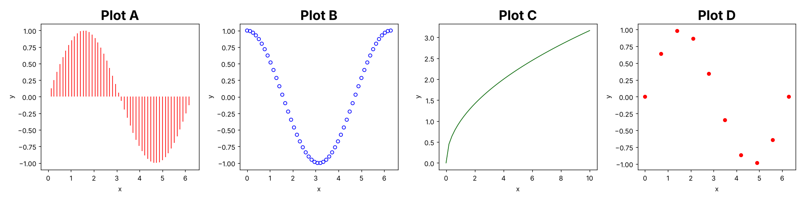
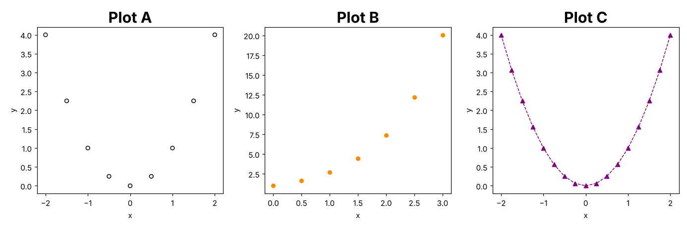
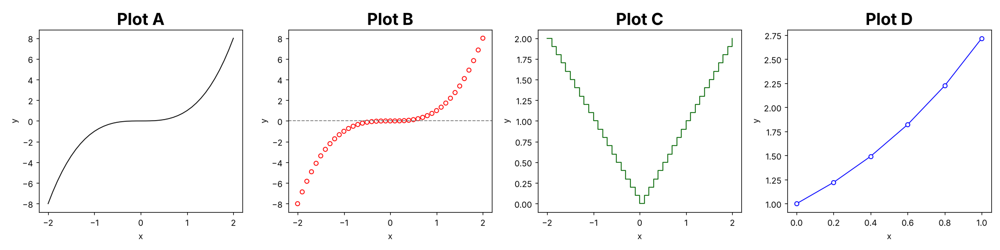

# R Programming for Beginners: Practice Exams (FEM11151)

There are three exams. Each one has the same 8 parts as the practice exam, and the content follows the course reader and lecture notes:

| # | Part | Where it is in the course material |
|---|------|------------------------------|
| 1 | Dataset outputs (`str()`, `length`, `dim`, `typeof`, `$` vs `subset`, factors) | Reader (data structures), Lecture 2 (discover) |
| 2 | RMarkdown: YAML header and broken code chunks | Lecture 4 Reporting (YAML, knitr chunk options, inline code) |
| 3 | Plotting function: give the calls for the plots shown, plus base graphics arguments | Lecture 4 Data visualisation (`plot`, `type`, `pch`, `col`, `lines`, `legend`, `par`) |
| 4 | Writing functions: fill in the blanks, `return()`, loops | Reader (functions, arguments by name/position), Lecture 5 (customised functions, control structures, loops) |
| 5 | Statistics functions, matrices and `apply()` | Reader (matrices), Lecture 2 (`var`, `sd`, `colMeans`) |
| 6 | Debugging dplyr and base R code, and using `lm()` | Lecture 2 (`subset`, `aggregate`, `transform`, dplyr verbs, `%>%`), Reader (`lm`, `boxplot`) |
| 7 | Data vectors: dates, factors, ordered factors | Lecture 3 (`factor`, `relevel`, `levels<-`, `as.Date`, `difftime`, `lubridate`) |
| 8 | Coercion | Reader (data types, "upwards"/"downwards" coercion) |
| 9 | Indexing and data.table | Lecture 5 (vector/matrix/list/data frame indexing, `which`, `order`, `%in%`), Lecture 6 (`fread`, `DT[i, j, by]`, `.N`, `.()`, `keyby`, `%like%`, `%chin%`, `%between%`) |
| 10 | Regular expressions and web scraping | Lecture 7 (`grep`, `grepl`, `sub`, `gsub`, `strsplit`, regex classes and quantifiers, `regmatches`, `rvest`) |

Parts 1–8 follow the practice exam exactly. Parts 9 and 10 are **extra** parts for Lectures 5–7, which the practice exam does not show separately. Lecture 5 material (functions, `return()`, `if`/`else if`, loops) is also built into Part 4.

Solutions are in `R_practice_exams_solutions.md`. That file also solves **the original practice exam**.

> **Coercion in the reader's terminology.** The ranking is character > logical > integer > double (low → high cardinality). Coercion to character is "downwards" (`c(0.5, "a")` → `"0.5" "a"`). Coercion to double is "upwards" (`c(0.5, 1L)` → `0.5 1.0`).

---
---

# Practice Exam 1

## 1. Ben & Jerry's Ice Cream

The `BenAndJerry` dataset is a subsample of the Nielsen homescan panel:

```
> str(BenAndJerry)
Classes 'tbl_df', 'tbl' and 'data.frame':  21974 obs. of 12 variables:
 $ quantity           : int 2 1 1 1 1 2 2 1 1 1 ...
 $ price_paid_deal    : num 6.82 3.5 3.5 0 0 0 0 2.14 3.5 3 ...
 $ price_paid_non_deal: num 0 0 0 3 3.99 7.78 7.78 0 0 0 ...
 $ coupon_value       : num 1 0 0 0 0 0 0 0 0 1.25 ...
 $ promotion_type     : int 2 1 1 NA NA NA NA 1 1 2 ...
 $ total_spent        : num 37.2 31 15.5 113 67.3 ...
 $ size1_descr        : chr "16.0 MLOZ" "16.0 MLOZ" "16.0 MLOZ" "16.0 M"..
 $ flavor_descr       : chr "CAKE BATTER" "VAN CARAMEL FUDGE" "VAN CARA"..
 $ formula_descr      : chr "REGULAR" "REGULAR" "REGULAR" "REGULAR" ...
 $ household_id       : int 2001456 2001456 2001456 2001637 2002791 2002..
 $ female_head_birth  : chr NA NA NA "10/1/36" ...
 $ male_head_birth    : chr "10/1/61" "10/1/61" "10/1/61" NA ...
```

What is the output of the following data operations?

```r
# A.)
length(BenAndJerry)

# B.)
dim(BenAndJerry$total_spent)

# C.)
dim(subset(BenAndJerry, select = c(quantity, total_spent)))

# D.)
typeof(BenAndJerry$household_id)

# E.)
levels(BenAndJerry$flavor_descr)

# F.)
class(BenAndJerry[, 6])

# G.)
sum(is.na(BenAndJerry$promotion_type[1:10]))
```

## 2. RMarkdown

Complete the YAML header so that (1) the file is rendered into a **pdf** document, (2) the sections are **numbered**, (3) all figures are **6 inches wide and 4 inches high** by default, and (4) data frames are printed as **kable** tables.

The RMarkdown file also contains several mistakes, so R won't render it and gives an error message instead. Spot the mistakes in the embedded code chunks.

````markdown
---
title: "Ben & Jerry's Report"
author: "Eager Student"
---

```{r setup, include = FALSE}
knitr::opts_chunk$set(echo = TRUE)
load("BenAndJerry.RData")
library(ggplot2)
```

# Prices

The average amount spent is `r round(mean(BenAndJerry$total_spent), 2` dollars.

```{r price-plot, fig.align = center}
ggplot(BenAndJerry, aes(x = price_paid_deal)) +
  geom_histogram()
```

```{r price-table, results = 'hide}
summary(BenAndJerry$price_paid_deal)
```

```{r kable-table}
kable(head(BenAndJerry)) %>%
  kable_styling(full_width = FALSE)
```
````

## 3. draw_curve()

The function `draw_curve()` below draws any single-variable mathematical function for a given sequence of values:

```r
draw_curve <- function(fun = cos, from = 0, to = 2 * pi, length.out = 50,
                       col = "blue", type = "l") {

  x <- seq(from = from, to = to, length.out = length.out)
  y <- fun(x)

  if (type == "dots") {
    plot(x, y, col = col, pch = 19)
  }
  else {
    plot(x, y, col = col, type = type)
  }
}
```

a) Provide the function calls that produce the following curves:



- **Plot A:** red vertical lines.
- **Plot B:** 50 open blue circles.
- **Plot C:** a dark-green line from 0 to 10.
- **Plot D:** 10 filled red points.

b) Which `par()` setting arranges four plots **next to each other in one row**? How do you switch back to the default settings afterwards?

c) Plot C should get the title `"Square root"` and bigger plotting symbols (twice the default size). The function has no argument for this. Which two small changes to `draw_curve()` let you pass extra arguments such as `main` or `cex` on to `plot()`?

## 4. Means

The arithmetic mean is the sum of all elements divided by the number of elements. Complete the code below to write a function `my.mean()` that computes the mean **with a for-loop** (without `sum()` or `mean()`):

```r
my.mean <- function(x){
  total <- 0
  for(___ in ___){
    total <- ___
  }
  ___
}

my.mean(c(2, 4, 9))
# 5
```

The **trimmed mean** discards the `k` smallest and the `k` largest values before computing the mean. Complete `trim.mean()`. If the vector has `2*k` elements or fewer, the function should stop with the error message `"k is too large!"`.

```r
trim.mean <- function(x, k = 1){
  ___(length(x) <= 2 * k) ___("k is too large!")
  x <- sort(x)
  my.mean(x[___])
}

trim.mean(c(100, 1, 2, 3, -50))
# 2
trim.mean(1:10, k = 3)
# 5.5
```

The **geometric mean** of positive numbers is `exp(mean(log(x)))`. Complete `geo.mean()` using `my.mean()`. It should stop if any element is not positive:

```r
___ {
  if(___) stop("all values must be positive!")
  ___
}

geo.mean(c(1, 10, 100))
# 10
```

Finally, which of these calls of `trim.mean()` are valid, and what do they return?

```r
trim.mean(k = 2, x = 1:10)
trim.mean(1:10, 2)
trim.mean(2, 1:10)
```


**Lecture 5 traps.** What do these calls return?

```r
foo <- function(x){
  return (2/5) * x
}
foo(10)

sign <- function(x) {
  if (x < 0) {
    "negative"
  } else if (x == 0) {
    "zero"
  } else {
    "positive"
  }
}
sign(0)
sign(c(-1, 1))
```
## 5. Exam Scores

**Matrix warm-up**

```r
a <- 1:6

# A.)
A <- matrix(a, ncol = 2)
A

# B.)
B <- matrix(a, ncol = 2, byrow = TRUE)
B[3, 1]

# C.)
dim(t(A))

# D.)
matrix(1:4, ncol = 3)
```

**Standard deviation and standard error**

The sample standard deviation is

`sd(x) = sqrt( sum((x - mean(x))^2) / (n - 1) )`

Complete `my.sd()`:

```r
my.sd <- function(x) {
  n <- length(x)
  if (n < 2) stop("x must have at least 2 elements!")
  ___
}
```

The **standard error of the mean** is `se(x) = sd(x) / sqrt(n)`. Complete `my.se()` using `my.sd()`:

```r
my.se <- function(x) {
  ___
}
```

Consider the matrix `scores` with exam points of students (rows) in four subjects (columns):

```
> scores
       Math Stats Programming English
Ann      78    85          92      64
Ben      55    61          70      88
Carla    91    94          99      72
David    67    70          58      81
Eva      83    77          88      90
```

a) Apply `my.se()` to get the standard error for **every subject**.
b) Give two ways to get the average score of **every subject**: one with `apply()` and one with a special matrix function from the lecture.
c) Apply `my.mean()` from part 4 to get the average score of **every student**.

## 6. Fuel Economy (`mpg`)

You are writing a report on the `mpg` dataset (234 cars, from `ggplot2`):

```
> head(mpg)
# A tibble: 6 × 11
  manufacturer model displ  year   cyl trans      drv     cty   hwy fl    class
  <chr>        <chr> <dbl> <int> <int> <chr>      <chr> <int> <int> <chr> <chr>
1 audi         a4      1.8  1999     4 auto(l5)   f        18    29 p     compact
2 audi         a4      1.8  1999     4 manual(m5) f        21    29 p     compact
3 audi         a4      2    2008     4 manual(m6) f        20    31 p     compact
4 audi         a4      2    2008     4 auto(av)   f        21    30 p     compact
5 audi         a4      2.8  1999     6 auto(l5)   f        16    26 p     compact
6 audi         a4      2.8  1999     6 manual(m5) f        18    26 p     compact
```

A colleague's data-exploration code is not working. Spot the mistake in each snippet that causes the error message.

```r
# A.)
mpg %>%
  mutate(cty_kml = cty * 0.425,
         hwy_kml = hwy * 0.425) %>%
  summarize(M.city = mean(cty_kmpl),
            M.highway = mean(hwy_kml))

Error in `summarize()`:
  In argument: `M.city = mean(cty_kmpl)`.
Caused by error:
  object 'cty_kmpl' not found

# B.)
mpg %>%
  filter(year = 2008) %>%
  select(manufacturer, model, hwy)

Error in `filter()`:
  We detected a named input.
  This usually means that you've used `=` instead of `==`.

# C.)
mpg %>%
  group_by(class) %>%
  summarize(total = n, M.hwy = mean(hwy))

Error in `summarize()`:
  In argument: `total = n`.
Caused by error:
  `total` must be a vector, not a function.

# D.)
aggregate(hwy ~ class, data = mpg, FUN = mean())

Error in mean.default() : argument "x" is missing, with no default
```

Next, you look at how the drive train `drv` (`"4"`, `"f"`, `"r"`) influences highway mileage:

```r
res <- lm(hwy ~ drv, data = mpg)
```

a) What do `length(res$coefficients)` and `length(res$residuals)` return?

b) Fill in the blanks so that the plot shows boxplots of `hwy` per drive train, the model predictions per drive train in **blue** on top of them, and a legend in the top right:

```r
boxplot(___, data = mpg, xlab = "drive train")
boxplot(___, data = mpg,
        border = "blue", outline = FALSE, add = TRUE)
legend(___, ___, col = "blue", lwd = 2)
```

c) Why does every blue "box" collapse to a single line?

## 7. Data Vectors

```r
# A.)
d <- as.Date(c("3/14/24", "12/1/23"), format = "%m/%d/%y")
d

range(d)

quarters(d)

d[1] - d[2]

# B.)
fat <- factor(c("REGULAR", "LIGHT", "REGULAR"))

as.numeric(fat)

as.numeric(relevel(fat, ref = "REGULAR"))

range(fat)

# C.)
levels(fat) <- c("< 20% fat", "> 20% fat")
fat

# D.)
sizes <- factor(c("M", "XL", "S", "M"),
                levels = c("S", "M", "L", "XL"), ordered = TRUE)

range(sizes)

sizes > "M"

table(sizes)
```

## 8. Coercion

What does `typeof()` return after each operation: logical, integer, double or character? Say whether the coercion is "upwards" or "downwards" in the reader's terminology.

```r
A <- c(1.5, 2, 3)
A[2] <- 7L
typeof(A)

B <- 1:5
B[6] <- 2.5
typeof(B)

C <- c(TRUE, FALSE)
C[2] <- "FALSE"
typeof(C)

D <- 1:3
D[5] <- 10L
typeof(D)
D            # also give the printed vector!

dbl <- c(0.5, 0.6)
chr <- c("a", "b")
E <- c(dbl, chr)
typeof(E); E
```


## 9. Indexing and data.table

**Indexing (Lecture 5).** What is the output?

```r
x_vec <- 2 * (1:10)

# A.)
x_vec[c(-1, -10)]

# B.)
x_vec[x_vec > 5 & x_vec < 12]

# C.)
x_vec %in% c(4, 7, 8)

x_mat <- matrix(1:12, nrow = 3)

# D.)
x_mat[8]

# E.)
x_mat[2, 3]

# F.)
x_mat[c(2, 3)]

vec <- c(5, 0, 12, 0, 3)

# G.)
which(vec == 0)

# H.)
which.max(vec)

# I.)
order(vec)
```

**data.table (Lecture 6).** You read the New York flights data with `fread()`:

```
> flights <- fread("flights14.csv")
> dim(flights)
[1] 253316     10
> head(flights, 3)
    year month   day dep_delay arr_delay carrier origin   dest air_time distance
   <int> <int> <int>     <int>     <int>  <char> <char> <char>    <int>    <int>
1:  2014     1     1        14        13      AA    JFK    LAX      359     2475
2:  2014     1     1        -3        13      AA    JFK    LAX      363     2475
3:  2014     1     1         2         9      AA    JFK    LAX      351     2475
```

a) What is the difference between `flights[, origin]`, `flights[, "origin"]` and `flights[, .(origin)]`?
b) Select `dep_delay` and `arr_delay`, renamed to `delay_dep` and `delay_arr`.
c) Return the **last 3 rows** using `.N`.
d) Count the flights of carrier `"DL"` per origin airport, sorted from most to fewest.
e) Compute the mean arrival delay per month for flights departing from JFK. Sort by month using the grouping argument itself.

## 10. Regular Expressions and Web Scraping

```r
x <- c("RStudio", "v.0.99.484", "2015", "09-22-2015", "grep vs. grepl")

# A.)
grepl("[0-9]", x)

# B.)
grep("[Gg]", x)

# C.)
gsub("\\d", "#", "Room 101")

# D.)
gsub("[0-9]+", "#", "Room 101, floor 3")

# E.)
sub("o", "0", "foo boo")
gsub("o", "0", "foo boo")

# F.)
strsplit("a,b,,c", ",")
```

G.) Complete the code so that it extracts all hashtags (a `#` followed by one or more letters, digits or underscores) from the tweet:

```r
tweet <- "Exam prep #RStats with #data_table and #regex2025!"
regmatches(tweet, ___(___, tweet))[[1]]
# "#RStats" "#data_table" "#regex2025"
```

H.) Web scraping with `rvest`. Which function do you use to:
1. parse the HTML of a web page from its URL,
2. extract **all** tables of the page as a list of data frames,
3. select all nodes with the CSS class `price`,
4. get the text out of the selected nodes?

I.) The scraped price is `"€ 1,299.00"`. Convert it into the number `1299` with one `gsub()` and `as.numeric()`.
---
---

# Practice Exam 2

## 1. Bike Sharing Chicago

`Chicago.agg` is an aggregated version of 9.5 million Divvy bike trips:

```
> str(Chicago.agg)
'data.frame':   12433 obs. of 7 variables:
 $ week        : int 1 1 1 1 1 1 1 1 1 1 ...
 $ usertype    : chr "Subscriber" "Subscriber" "Subscriber" "Subscriber"..
 $ gender      : chr "Female" "Female" "Female" "Female" ...
 $ events      : chr "clear" "clear" "clear" "clear" ...
 $ temperature : num -4 0 1 1.9 3 3.9 5 6.1 7 8.1 ...
 $ tripduration: num 4.22 8.58 5.47 10.4 8.01 ...
 $ no.customers: int 1 14 2 21 9 46 4 2 3 3 ...
```

What is the output of the following data operations?

```r
# A.)
ncol(Chicago.agg)

# B.)
typeof(Chicago.agg[, 5])

# C.)
typeof(Chicago.agg[5])

# D.)
summary(Chicago.agg$events)

# E.)
head(Chicago.agg$no.customers, 3) * 2

# F.)
Chicago.agg$temperature[Chicago.agg$temperature < 1][1:2]

# G.)
names(Chicago.agg)[c(1, 7)]
```

## 2. RMarkdown

Complete the YAML header so that (1) the file is rendered into an **HTML** document, (2) a table of contents is created with all level 1, 2 **and** 3 headers (which option can you leave out here, and why?), and (3) the code uses the **tango** syntax highlighting style.

The file below contains several mistakes that stop it from rendering. Spot them. The inline sentence in the "Temperature" section would render, but it shows a useless value. Why, and how do you fix it?

````markdown
---
title: "Chicago Bike Trips"
author: "Eager Student"
---

```{r setup, include = FALSE}
knitr::opts_chunk$set(echo = TRUE)
```

# Trip Duration by Weather

```{r duration-plot, fig.cap = Trip duration per weather event}
boxplot(tripduration ~ events, data = Chicago.agg)
```

```{r load-data, include = FALSE}
Chicago.agg <- read.csv("Chicago.agg.csv)
Chicago.agg$temperature[3] <- NA
```

# Temperature

The average temperature was `r mean(Chicago.agg$temperature)` degrees.

```{r load-data}
hist(Chicago.agg$temperature)
```

The relationship is modelled as $y = \beta_0 + \beta_1 x$.
````

## 3. draw_points()

The function `draw_points()` draws any single-variable function as points, optionally connected with a dashed line:

```r
draw_points <- function(fun = function(x) x^2, from = -2, to = 2, by = 0.5,
                        col = "black", pch = 1, line = FALSE) {

  x <- seq(from = from, to = to, by = by)
  y <- fun(x)

  plot(x, y, col = col, pch = pch)
  if (line) {
    lines(x, y, col = col, lty = 2)
  }
}
```

a) Provide the function calls that produce the following plots. (`pch = 1`: open circle, `pch = 17`: filled triangle, `pch = 19`: filled circle.)



- **Plot A:** 9 open black circles.
- **Plot B:** filled dark-orange circles from 0 to 3.
- **Plot C:** purple triangles with a dashed line, 17 points.

b) How many points does `draw_points(from = 0, to = 10, by = 2)` draw?

c) After calling `draw_points(line = TRUE)`, you want to add a legend in the top left that explains the dashed line as `"x squared"`, **without** a box around it. Complete: `legend(___, ___, lty = ___, bty = ___)`.

d) Give three different ways to specify the colour red for the `col` argument (colour name, RGB and hex).

## 4. Cumulative Sums and Maxima

The cumulative sum of a vector is a vector of the same length whose i-th element is the sum of the first i elements. For example, `c(3, 1, 4, 1)` gives `c(3, 4, 8, 9)`. Complete `my.cumsum()` so that it works **without** `cumsum()` or `sum()`:

```r
my.cumsum <- function(x){
  out <- numeric(length(x))
  out[1] <- ___
  for(i in ___){
    out[i] <- ___
  }
  out
}
```

Complete `my.which.max()`, which returns the **position** of the (first) maximum without using `which.max()` or `max()`:

```r
my.which.max <- function(x){
  pos <- 1
  for(i in seq_along(x)){
    if(___){
      ___
    }
  }
  ___
}

my.which.max(c(4, 9, 2, 9))
# 2
```

Min-max **normalisation** rescales a vector to [0, 1]: `(x - min(x)) / (max(x) - min(x))`. Complete the function so that it stops with `"all values are equal!"` if the denominator would be 0:

```r
normalize <- function(x){
  ___
  ___
}

normalize(c(2, 4, 6, 10))
# 0.00 0.25 0.50 1.00
```


**Multiple outputs and multiple inputs (Lecture 5).** What do the lines marked A–F return?

```r
stats2 <- function(x) {
  m <- mean(x)
  s <- sd(x)
  list(mean = m, sd = s)
}
res <- stats2(c(2, 4, 6))
res$sd       # A
res[[1]]     # B
class(res)   # C

sum.diff <- function(vec1 = 0, vec2 = 0) {
  sum(vec1 - vec2)
}
a <- c(1, 3)
b <- c(2, 4)
sum.diff(a, b)       # D
sum.diff(b, a)       # E
sum.diff(vec2 = b)   # F
```
## 5. Step Counts

**Matrix warm-up**

```r
M <- matrix(c(2, 1, 1, 3), ncol = 2)

# A.)
M * M

# B.)
M %*% M

# C.)
det(M)

# D.)
solve(M)

# E.)
cbind(M, rbind(M, M))
```

**z-scores**

The **z-score** standardises a vector: `z(x) = (x - mean(x)) / sd(x)`.

a) Write `my.sd()` (sample standard deviation, see Exam 1, Part 5) from scratch.

b) Complete `my.zscore()` using `my.sd()`:

```r
my.zscore <- function(x) {
  if (length(x) < 2) stop("x is not a vector!")
  ___
}
```

Consider the matrix `steps` with daily step counts for four persons:

```
> steps
       Mon   Tue   Wed   Thu   Fri   Sat   Sun
Anna  8200  7500  9100  8800  7900 12000  4300
Bilal 4100  5200  3900  6100  4500  9800 11000
Chen 10500 11200  9800 10100 12300  6400  7000
Dana  6000  6000  6000  6000  6000  6000  6000
```

c) Apply `my.sd()` to every **person**.
d) Apply `my.zscore()` to every person. What are the dimensions of the result, and why do you need `t()` to get one person per row back?
e) Which person causes a problem in d), and what happens?

## 6. Diamonds

You analyse the `diamonds` dataset (53,940 diamonds, from `ggplot2`):

```
> head(diamonds, 3)
# A tibble: 3 × 10
  carat cut     color clarity depth table price     x     y     z
  <dbl> <ord>   <ord> <ord>   <dbl> <dbl> <int> <dbl> <dbl> <dbl>
1  0.23 Ideal   E     SI2      61.5    55   326  3.95  3.98  2.43
2  0.21 Premium E     SI1      59.8    61   326  3.89  3.84  2.31
3  0.23 Good    E     VS1      56.9    65   327  4.05  4.07  2.31
```

Spot the mistake in each snippet:

```r
# A.)
diamonds %>%
  filter(cut == Ideal) %>%
  summarize(M.price = mean(price))

Error in `filter()`:
  In argument: `cut == Ideal`.
Caused by error:
  object 'Ideal' not found

# B.)
diamonds %>%
  group_by(cut) %>%
  summarize(M.price = mean(price)) %>%
  arrange(desc(price))

Error in `arrange()`:
  Caused by error:
  object 'price' not found

# C.)
diamonds %>%
  mutate(price_eur = price * 0.92) %>%
  ggplot(aes(x = carat, y = price_eur)) %>%
  geom_point()

Error in `geom_point()`:
  `mapping` must be created by `aes()`.
  Did you use `%>%` or `|>` instead of `+`?

# D.)
subset(diamonds, select = c(carat, price), subset = cut = "Ideal")

Error: unexpected '=' in "subset(diamonds, select = c(carat, price), subset = cut ="
```

Next, you fit a model for the price:

```r
res <- lm(price ~ carat + cut, data = diamonds)
```

a) How many elements do `res$fitted.values` and `res$coefficients` have? (`cut` has 5 levels.)

b) Fill in the blanks to draw a **residual plot**: the model predictions on the x-axis, the residuals on the y-axis, and a red horizontal reference line at 0:

```r
plot(x = ___, y = ___, xlab = "fitted values", ylab = "residuals")
abline(___ = 0, col = "red", lwd = 2)
```

c) Rewrite snippet B with base R `aggregate()` so that you get the mean price per `cut`.

## 7. Data Vectors

```r
# A.)
seq(as.Date("2024-01-31"), by = "month", length.out = 3)

library(lubridate)
as.Date("2024-01-31") %m+% months(0:2)

# B.)
dates <- as.Date("2024-12-30") + 0:3
wd <- weekdays(dates)
wd
[1] "Monday"    "Tuesday"   "Wednesday" "Thursday"

f <- factor(wd, levels = c("Monday", "Tuesday", "Wednesday",
                           "Thursday", "Friday"), ordered = TRUE)
range(f)

max(f[f < "Wednesday"])

# C.)
difftime(as.Date("2024-03-01"), as.Date("2024-02-01"), units = "hours")

# D.)
grades <- factor(c("B", "A", "C", "B"),
                 levels = c("C", "B", "A"),
                 labels = c("fair", "good", "excellent"), ordered = TRUE)
grades

range(grades)

as.integer(grades)
```

## 8. Coercion

What does `typeof()` return, and what does the result look like?

```r
A <- c(TRUE, FALSE, TRUE)
A[2] <- 3.5
typeof(A); A

B <- letters[1:3]
B[2] <- TRUE
typeof(B); B

C <- 1:4
C[2] <- NA
typeof(C)

D <- c(1L, 2L)
D[2] <- 2
typeof(D)

E <- cbind(1:2, c("a", "b"))
typeof(E)

x <- c(1, "2", 3)
sum(x)
sum(as.numeric(x))
```


## 9. Indexing and data.table

**List and data frame indexing (Lecture 5).**

```r
lst <- list(vec = 1:5, mat = matrix(1:4, nrow = 2), text = "hi")

# A.)
class(lst[2])

# B.)
lst[[2]][2, 1]

# C.)
lst$vec[lst$vec > 2]

# D.)
length(lst[-1])

df <- data.frame(a = 1:3, b = c(10, 20, 30))

# E.)
df[df > 5]

# F.)
df[[2]][2]

# G.)
class(df[2])
```

**data.table (Lecture 6)**, using the `flights` data from `flights14.csv`:

```
> flights <- fread("flights14.csv")
> dim(flights)
[1] 253316     10
> head(flights, 3)
    year month   day dep_delay arr_delay carrier origin   dest air_time distance
   <int> <int> <int>     <int>     <int>  <char> <char> <char>    <int>    <int>
1:  2014     1     1        14        13      AA    JFK    LAX      359     2475
2:  2014     1     1        -3        13      AA    JFK    LAX      363     2475
3:  2014     1     1         2         9      AA    JFK    LAX      351     2475
```

a) How do you convert an existing data.frame `flights_df` into a data.table without copying it?
b) How many flights went to a destination containing `"SFO"` in March? (Use `%like%`.)
c) Compute the mean departure delay per carrier, only for carriers `"AA"` and `"UA"`. (Use `%chin%`.)
d) How many flights had an arrival delay between −10 and 10 minutes? (Use `%between%`.)
e) What does `.N` contain when it is used (i) without `by` and (ii) with `by = origin`?
f) What is the difference between `by = .(origin, dest)` and `keyby = .(origin, dest)`?

## 10. Regular Expressions and Web Scraping

```r
# A.)
gsub("[[:punct:]]", "", "Hello, World!")

# B.)
sub("New", "Old", c("New New York", "new York"))

# C.)
sub("New", "Old", c("New New York", "new York"), ignore.case = TRUE)

# D.)
sub("\\$", "EUR ", "$100")

# E.)
gsub("a+", "a", "baaad caat")

# F.)
grepl("[0-9]{4}", c("2024", "v24", "12345"))

# G.)
grep("North", c("New England", "East North Central", "West North Central"),
     value = TRUE)
```

H.) Complete `count_words()`, which returns the number of words in a string. Words can be separated by one **or more** whitespace characters:

```r
count_words <- function(s) {
  length(strsplit(s, ___)[[1]])
}
count_words("R  is   fun")
# 3
```

I.) You scrape the "Scrape This Site" country page:

```r
page <- read_html("https://www.scrapethissite.com/pages/simple/")
info <- page %>%
  html_nodes(".country-population,.country-area") %>%
  html_text()
info[1:4]
[1] "84000"   "468.0"   "4975593" "82880.0"
```

1. In which order do population and area appear in `info`?
2. Write code that keeps only the **populations** (every second element, starting with the first) and computes their sum as a number.
---
---

# Practice Exam 3

## 1. Air Quality

The built-in `airquality` dataset contains daily air quality measurements in New York (May–September 1973):

```
> str(airquality)
'data.frame':   153 obs. of  6 variables:
 $ Ozone  : int  41 36 12 18 NA 28 23 19 8 NA ...
 $ Solar.R: int  190 118 149 313 NA NA 299 99 19 194 ...
 $ Wind   : num  7.4 8 12.6 11.5 14.3 14.9 8.6 13.8 20.1 8.6 ...
 $ Temp   : int  67 72 74 62 56 66 65 59 61 69 ...
 $ Month  : int  5 5 5 5 5 5 5 5 5 5 ...
 $ Day    : int  1 2 3 4 5 6 7 8 9 10 ...
```

What is the output of the following data operations? (Only two days have a wind speed above 20 mph: 9 May and 17 June.)

```r
# A.)
dim(airquality)

# B.)
mean(airquality$Ozone)

# C.)
sum(is.na(airquality$Ozone[1:10]))

# D.)
airquality[airquality$Wind > 20, "Day"]

# E.)
typeof(airquality$Temp * 2L)

# F.)
class(airquality[, c("Temp", "Month")])

# G.)
range(airquality$Month)
```

## 2. RMarkdown

Complete the YAML header so that (1) the file is rendered into a **Word** document, and (2) a table of contents with headers up to **level 2** is created. In addition, (3) change the setup chunk so that, for the **whole document**, no code and no messages are shown in the output. (4) Which output format would you put in the YAML header to create **PowerPoint slides** instead?

Spot the mistakes that stop the file from rendering:

````markdown
---
title: "Air Quality in New York"
author: "Eager Student"
---

```{r setup, include = FALSE}
knitr::opts_chunk$set(echo = TRUE)
library(ggplot2)
```

# Ozone by Month

```{r boxplot}
airquality %>%
  ggplot(aes(x = factor(Month), y = Ozone)) +
  geom_boxplot
```

```{r counts, results = hide}
aggregate(Ozone ~ Month, data = Airquality, FUN = mean)
``

# Conclusion

Ozone levels peak in July and August.
````

## 3. draw_curve()

```r
draw_curve <- function(fun = function(x) x^3, from = -2, to = 2,
                       length.out = 41, col = "black", type = "l",
                       zero = FALSE) {

  x <- seq(from = from, to = to, length.out = length.out)
  y <- fun(x)

  plot(x, y, col = col, type = type)
  if (zero) {
    abline(h = 0, col = "grey", lty = 2)
  }
}
```

a) Provide the function calls that produce the following plots. (`type = "s"` draws steps, and `type = "b"` draws both points and lines.)



- **Plot B:** red open circles with a dashed grey line at y = 0.
- **Plot C:** a dark-green step curve of |x|.
- **Plot D:** blue, 6 points, 0 ≤ x ≤ 1.

b) Which `par()` setting arranges the 4 plots in a **2 × 2 grid, filled column by column**?

c) Recreate Plot A with `ggplot2`. Build a data frame with `x` and `y` and use `geom_line()`. Use the theme with a white background and no grid lines.

## 4. Maxima and Top-k

Complete `my.max()`, which returns the largest element of `x` using a loop (without `max()`, `sort()` or `range()`):

```r
my.max <- function(x){
  current <- ___
  for(v in ___){
    if(___) current <- v
  }
  current
}

my.max(c(3, 8, 1, 8, 5))
# 8
```

Complete `top.k()`, which returns the `k` largest values in decreasing order. If `k` is larger than the length of `x`, the whole sorted vector is returned:

```r
top.k <- function(x, k = 3){
  x <- sort(___, decreasing = ___)
  ___(k > length(x)){
    return(___)
  }
  x[___]
}

top.k(c(5, 1, 9, 7, 3))
# 9 7 5
top.k(c(2, 4), k = 5)
# 4 2
```

Write `my.range.width()`, which returns `max(x) - min(x)` using **only** `my.max()`. (Hint: the minimum of `x` is minus the maximum of `-x`.)

```r
___ {
  if(length(x) < 2) stop("x is not a vector!")
  ___
}
my.range.width(c(4, -2, 7))
# 9
```


**Loops (Lecture 5).**

```r
x <- 1:4
y <- integer(4)
for (i in 1:4) {
  y[i] <- x[i]^2
}
y            # A.) What is y?
             # B.) Write the vectorised version without a loop.

m <- matrix(0, nrow = 2, ncol = 3)
for (i in 1:2) {
  for (j in 1:3) {
    m[i, j] <- i * j
  }
}
m            # C.) Write down m.

for (i in 1:3) {
  z <- i * 10
}
z            # D.) What is z?
```
## 5. Stock Prices

**Matrix warm-up**

```r
x <- 1:3
y <- 4:6

# A.)
cbind(x, y)

# B.)
rbind(x, y)

# C.)
dim(cbind(rbind(x, y), rbind(x, y)))

# D.)
cbind(cbind(x, y), rbind(x, y))

# E.)
x * c(10, 100)
```

**Percent changes**

The daily **percent change** of a price series is

`pct(x) = (x[t] - x[t-1]) / x[t-1] * 100` for t = 2, …, n

a) Complete `pct.change()` with **vector operations** (no loop). Hint: `diff()` and `head(x, -1)`.

```r
pct.change <- function(x) {
  if (length(x) < 2) stop("x must have at least 2 elements!")
  ___
}
```

b) The **volatility** of a stock is the standard deviation of its percent changes. Complete `volatility()`:

```r
volatility <- function(x) {
  ___
}
```

Consider the matrix `stocks` with closing prices for one week:

```
> stocks
         Mon   Tue   Wed   Thu   Fri
ACME   100.0 102.0  99.0 101.5 104.0
Globex  50.0  50.5  51.0  50.0  52.0
Initech 20.0  18.0  21.0  19.5  20.5
```

c) Apply `volatility()` to every stock (row). Which stock do you expect to be the most volatile?
d) What are the dimensions of `apply(stocks, 1, pct.change)`? What are its row names and column names?
e) What is the first value of `pct.change(stocks["ACME", ])`?
f) Compute the average closing price of every stock with `rowMeans()`.

## 6. Star Wars (dplyr)

This time you use the tibble version `dplyr::starwars` (87 characters, with columns `name`, `height`, `mass`, `hair_color`, `gender`, `homeworld`, `species`, …). Spot the mistakes:

```r
# A.)
starwars %>%
  filter(species == "Human") %>%
  summarize(avg = mean(height, na.rm = TRUE)) %>%
  pull(avg_height)

Error in `pull()`:
  Can't extract columns that don't exist.
  Column `avg_height` doesn't exist.

# B.)
starwars %>%
  group_by(species) %>%
  summarize(n = n() M.height = mean(height, na.rm = TRUE))

Error: unexpected symbol in:
"  group_by(species) %>%
  summarize(n = n() M.height"

# C.)
library(dplyr)
starwars %>%
  select(name, height, mass) %>%
  left_join(planets, by = "homeworld")

Error in `left_join()`:
  Join columns in `x` must be present in the data.
  Problem with `homeworld`.

# D.)  No error, but the sd column contains only NA. Why?
starwars %>%
  group_by(gender) %>%
  summarize(height = mean(height, na.rm = TRUE),
            sd     = sd(height, na.rm = TRUE))
```

You model mass by height:

```r
res <- lm(mass ~ height, data = starwars)
```

a) `mass` has 28 missing values and `height` has 6. Every character with a missing height is also missing its mass. How long is `res$residuals`?

b) Fill in the blanks to draw a scatterplot of mass against height with filled points (`pch = 19`), the title `"Star Wars"`, and the regression line in red:

```r
plot(___, data = starwars, pch = ___, main = ___)
abline(___, col = "red", lwd = 2)
```

c) One character (Jabba, 1358 kg) has a huge residual. Which element of `res` would you use to find the largest residual, and which function returns its position?

## 7. Data Vectors

```r
# A.)
as.numeric(as.Date(c("1970-01-10", "1969-12-31")))

as.Date("17 March 2025", format = "%d %B %Y")

dates <- as.Date(c("2024-01-15", "2023-11-02", "2024-07-30"))
diff(range(dates))

format(range(dates), "%B")

# B.)
range(factor(months(dates)))

library(lubridate)
wday(as.Date("2024-01-01"), label = TRUE)

# C.)
level <- factor(c("high", "low", "medium", "high"),
                levels = c("low", "medium", "high"), ordered = TRUE)

min(level)

range(level[level != "low"])

relevel(level, ref = "high")

# D.)
library(plyr)
dir <- factor(c("N", "S", "N"))
revalue(dir, c("N" = "North"))
```

## 8. Coercion

```r
A <- seq(0, 1, by = 0.25)
A[1] <- "zero"
typeof(A)

B <- c(a = 1L, b = 2L)
B["c"] <- 3L
typeof(B); B

C <- rep(NA, 3)
typeof(C)
C[1] <- 5L
typeof(C)

D <- as.Date("2024-01-01")
typeof(D); class(D)

E <- factor(c("10", "20", "10"))
as.numeric(E)
as.numeric(as.character(E))

F <- list(1L, "a", TRUE)
typeof(F); typeof(F[[1]])
```

## 9. Indexing and data.table

**Indexing functions (Lecture 5)** on the built-in `mtcars` data (32 cars). The car with the lowest `mpg` is the Cadillac Fleetwood, the car with the highest `hp` is the Maserati Bora, and the three lowest `hp` values are 52, 62 and 65.

```r
# A.)
rownames(mtcars)[which.min(mtcars$mpg)]

# B.)
mtcars[which.max(mtcars$hp), "hp"] > 300

# C.)
head(mtcars[order(mtcars$hp), "hp"], 3)

# D.)
duplicated(c(1, 2, 2, 3, 1))

# E.)
is.finite(c(1, NA, Inf, -2))

# F.)
which(c(3, -1, 4) < 0 & c(TRUE, TRUE, FALSE))
```

**data.table (Lecture 6).** You convert `airquality` (see Part 1) into a data.table:

```r
library(data.table)
aq <- as.data.table(airquality)
```

a) What does `aq[.N]` return?
b) Compute the mean temperature per month.
c) Count the days per month **with** an ozone measurement (no `NA`).
d) How many days had a temperature between 80 and 90 °F?
e) What does `aq[order(-Wind)][1:2, Day]` return? (See the hint in Part 1.)
f) Why does `aq[, 4]` return a data.table, while `airquality[, 4]` returns a vector?

## 10. Regular Expressions and Web Scraping

```r
# A.)
gsub("\\w", "_", "R is 4 fun")

# B.)
gsub("\\D", "", "Tel: +31 (0)10 408")

# C.)
x <- "Call 010-1234 or 06-555 today"
regmatches(x, gregexpr("[0-9]+", x))[[1]]

# D.)
regmatches(x, gregexpr("[0-9-]+", x))[[1]]

# E.)
grep("[^0-9a-zA-Z]", c("R2D2", "C-3PO", "BB8", "K 2SO"), value = TRUE)
```

F.) Trace the sign-collapsing loop from Lecture 7 by hand. Which lines does it print?

```r
x <- "5-+--3"
while (grepl("\\+\\+|--|\\+-|-\\+", x)) {
  x <- gsub("\\+\\+", "+", x)
  x <- gsub("--", "+", x)
  x <- gsub("\\+-|-\\+", "-", x)
  print(x)
}
```

G.) Why is a `while` loop used here and not a `for` loop?

H.) Web scraping. You scraped a Wikipedia table with `beer.table <- html_table(read_html(url))`.
1. Why do you need `beer.table[[1]]` to get the actual table?
2. The country names contain footnote marks such as `"Czech Republic[a]"`. Remove all punctuation from `beer.table[[1]]$Country` with one `gsub()` call.
3. Why does the lecture convert `Country` into a factor with `levels = beer.table[[1]]$Country` before plotting with ggplot?
