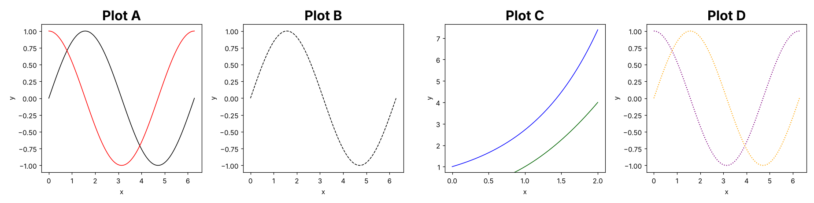
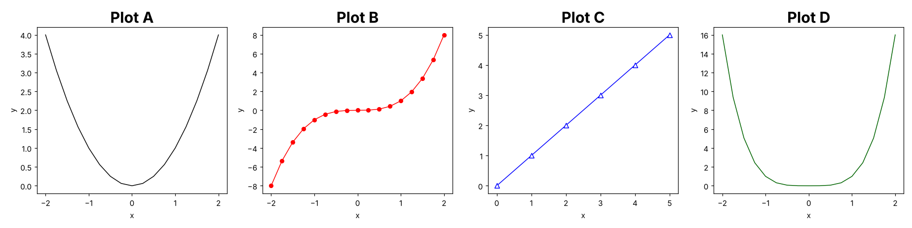

# R Programming for Beginners: Practice Exams 4 and 5 (FEM11151)

These two exams have the same 10-part structure as Exams 1–3 and cover the reader and Lectures 2–7. They use new datasets and include new traps. Solutions with explanations are in `R_practice_exams_2_solutions.md`.

| # | Part |
|---|---|
| 1 | Dataset outputs |
| 2 | RMarkdown (YAML header and broken chunks) |
| 3 | Plotting function: give the calls for the plots shown |
| 4 | Writing functions: fill in the blanks |
| 5 | Matrices, a statistics function and `apply()` |
| 6 | Debugging dplyr and base R code, and using `lm()` |
| 7 | Dates and factors |
| 8 | Coercion |
| 9 | Indexing and data.table |
| 10 | Regular expressions and web scraping |

---
---

# Practice Exam 4

## 1. New York Flights

The `flights` dataset (Lecture 6) contains all flights departing from New York in 2014. It was read with `fread()`:

```
> str(flights)
Classes 'data.table' and 'data.frame':  253316 obs. of  10 variables:
 $ year     : int  2014 2014 2014 2014 ...
 $ month    : int  1 1 1 1 ...
 $ day      : int  1 1 1 1 ...
 $ dep_delay: int  14 -3 2 -8 ...
 $ arr_delay: int  13 13 9 -26 ...
 $ carrier  : chr  "AA" "AA" "AA" "AA" ...
 $ origin   : chr  "JFK" "JFK" "JFK" "LGA" ...
 $ dest     : chr  "LAX" "LAX" "LAX" "PBI" ...
 $ air_time : int  359 363 351 157 ...
 $ distance : int  2475 2475 2475 1035 ...
```

What is the output of the following data operations?

```r
# A.)
length(flights)

# B.)
typeof(flights[, 4])

# C.)
typeof(flights[[4]])

# D.)
flights[1:4, dep_delay]

# E.)
flights[4, dest]

# F.)
sum(flights$arr_delay[1:4] < 0)

# G.)
levels(flights$origin)
```

## 2. RMarkdown

Complete the YAML header so that (1) the file is rendered into a **pdf** document, (2) a table of contents is created with the **default** depth (which headers are included then?), (3) the sections are **numbered**, and (4) **no syntax highlighting** is used.

The RMarkdown file also contains several mistakes, so R won't render it. Spot them.

````markdown
---
title: "Flight Delays"
author: "Eager Student"
---

```{r setup, include = FALSE}
library(data.table)
flights <- fread("flights14.csv")
```

# Delays per Carrier

```{r delay-plot}
barplot(delays$mean_delay, names.arg = delays$carrier)
```

```{r delay-table, eval = yes}
delays <- flights[, .(mean_delay = mean(arr_delay)), by = carrier
delays
```

The data contains `r nrow(flight)` flights.

```{r delay-table}
summary(flights$arr_delay)
```
````

## 3. draw_two()

The function `draw_two()` draws two single-variable functions in one plot:

```r
draw_two <- function(f1 = sin, f2 = cos, from = 0, to = 2 * pi, n = 100,
                     col = c("black", "red"), lty = 1, both = TRUE) {

  x <- seq(from = from, to = to, length.out = n)

  plot(x, f1(x), type = "l", col = col[1], lty = lty, ylab = "y")
  if (both) {
    lines(x, f2(x), col = col[2], lty = lty)
  }
}
```

a) Provide the function calls that produce the following plots. (`lty = 2` draws dashed lines and `lty = 3` dotted lines.)



- **Plot A:** black and red solid lines.
- **Plot B:** a single black dashed sine curve.
- **Plot C:** a blue `exp(x)` curve and a dark-green `x^2` curve on 0 ≤ x ≤ 2.
- **Plot D:** purple and orange dotted lines; the purple curve starts at 1.

b) In Plot C, the left part of the green curve is **missing**. Why? Which argument of `plot()` would you need to show it?

c) Write a `legend()` call for Plot A that labels the black line `"sin"` and the red line `"cos"` in the bottom left, without a box.

## 4. Mode and Prime Numbers

The **mode** is the most frequent value of a vector. Complete `my.mode()` using `table()` and `which.max()`. The result must be a **number**, not a character:

```r
my.mode <- function(x){
  tab <- ___(x)
  ___(names(tab)[___(tab)])
}

my.mode(c(2, 3, 3, 5, 3, 2))
# 3
```

Complete `is.prime()`, which returns `TRUE` if `n` is a prime number:

```r
is.prime <- function(n){
  if(n < 2) return(___)
  if(n == 2) return(___)
  for(d in 2:(n - 1)){
    if(___) return(FALSE)
  }
  ___
}
```

a) Why does the function need the special case `n == 2`? (Hint: what is `2:(2 - 1)`?)
b) What does `which(sapply(1:20, is.prime))` return?

What do these calls return?

```r
foo <- function(x) {
  x^2
  x + 1
}
foo(3)

bar <- function(x, y = x * 2) {
  x + y
}
bar(3)
bar(3, 1)
```

## 5. Sales

**Matrix warm-up**

```r
A <- matrix(1:6, nrow = 2, byrow = TRUE)

# A.)
A[2, ]

# B.)
A[, -1]

# C.)
A %*% c(1, 0, 1)

# D.)
dim(t(A) %*% A)

# E.)
A[A > 2]
```

**Mean absolute deviation**

The mean absolute deviation measures the average distance to the mean:

`mad.mean(x) = sum(|x - mean(x)|) / n`

Complete `mad.mean()`:

```r
mad.mean <- function(x) {
  if (length(x) < 2) stop("x is not a vector!")
  ___
}
```

The **relative** mean absolute deviation is `mad.mean(x) / mean(x) * 100`. Complete `rel.mad()` using `mad.mean()`:

```r
rel.mad <- function(x) {
  ___
}
```

Consider the matrix `sales` with quarterly sales (in 1000 units) of four products:

```
> sales
       Q1 Q2 Q3 Q4
Lamp   10 20 30 40
Chair  25 25 25 25
Desk   12 18 12 18
Shelf   5 50  5 20
```

a) Apply `mad.mean()` to every **product**. What is the result for `Lamp` and for `Chair`?
b) Apply `rel.mad()` to every product. Which product has the most unstable sales?
c) Compute the total sales per **quarter** with a special matrix function.

## 6. Iris Flowers

You analyse the built-in `iris` dataset (150 flowers, 3 species):

```
> str(iris)
'data.frame':   150 obs. of  5 variables:
 $ Sepal.Length: num  5.1 4.9 4.7 4.6 5 5.4 4.6 5 4.4 4.9 ...
 $ Sepal.Width : num  3.5 3 3.2 3.1 3.6 3.9 3.4 3.4 2.9 3.1 ...
 $ Petal.Length: num  1.4 1.4 1.3 1.5 1.4 1.7 1.4 1.5 1.4 1.5 ...
 $ Petal.Width : num  0.2 0.2 0.2 0.2 0.2 0.4 0.3 0.2 0.2 0.1 ...
 $ Species     : Factor w/ 3 levels "setosa","versicolor",..: 1 1 1 1 1 1 1 1 1 1 ...
```

Spot the mistake in each snippet:

```r
# A.)
iris %>%
  group_by(Species) %>%
  summarize(M = mean(Sepal.length))

Error in `summarize()`:
  In argument: `M = mean(Sepal.length)`.
Caused by error:
  object 'Sepal.length' not found

# B.)
iris %>%
  filter(Species == "setosa" | "virginica")

Error in `filter()`:
  In argument: `Species == "setosa" | "virginica"`.
Caused by error in `Species == "setosa" | "virginica"`:
  operations are possible only for numeric, logical or complex types

# C.)
iris %>%
  arrange(desc(Petal.Width)) %>%
  select(Species Petal.Width)

Error: unexpected symbol in:
"  arrange(desc(Petal.Width)) %>%
  select(Species Petal.Width"

# D.)
aggregate(Sepal.Length, Species, data = iris, FUN = mean)

Error: object 'Sepal.Length' not found
```

Next, you model the petal length by species:

```r
res <- lm(Petal.Length ~ Species, data = iris)
```

a) What do `length(res$coefficients)` and `length(res$residuals)` return? What are the names of the coefficients?
b) Which species is the **reference level**, and why? What does the intercept estimate?
c) Write one line that makes `virginica` the reference level before fitting the model.
d) Fill in the blanks so that the boxplots of the petal length per species get a **light grey** fill, the model predictions are drawn on top in red, and a legend appears in the top left:

```r
boxplot(___, data = iris, col = ___)
boxplot(res$fitted.values ~ Species, data = iris,
        border = "red", outline = FALSE, add = ___)
legend(___, "model predictions", col = "red", lwd = 2)
```

## 7. Dates and Factors

```r
# A.)
d <- as.Date("2025-02-27") + 0:3
d

months(d)

quarters(d[4])

# B.)
difftime(d[4], d[1], units = "weeks")

# C.)
format(as.Date("2025-12-24"), "%d %b %Y")

as.Date("24.12.2025", format = "%d.%m.%Y")

as.numeric(as.Date("1970-02-01"))

# D.)
seq(as.Date("2025-01-31"), by = "month", length.out = 2)

library(lubridate)
as.Date("2025-01-31") %m+% months(1)

# E.)
rating <- factor(c("low", "high", "mid", "high"),
                 levels = c("low", "mid", "high"))
levels(rating)[2] <- "medium"
rating

as.integer(rating)

rating == "high"

max(rating)

# F.)
library(plyr)
mapvalues(rating, from = c("low", "high"), to = c("L", "H"))
```

## 8. Coercion

What does each line return?

```r
A <- c(1L, 2L, 3L)
A[2] <- TRUE
typeof(A); A

B <- matrix(1:4, nrow = 2)
B[1, 1] <- 2.5
typeof(B)

C <- data.frame(n = 1:2, s = c("a", "b"))
sapply(C, typeof)

typeof(NA)

as.integer("3.9")

as.numeric("abc")

as.logical(c("TRUE", "yes", "0"))

as.logical(0:2)
```

## 9. Indexing and data.table

**Vectors and lists (Lecture 5)**

```r
v <- c(a = 10, b = 20, c = 30, d = 40)

# A.)
v["c"]

# B.)
v[c(TRUE, FALSE)]

# C.)
v[v > 15 & names(v) != "d"]

# D.)
which(v == max(v))

l <- list(a = 1:3, b = list(c = "x", d = 5))

# E.)
l$b$d

# F.)
l[["b"]][["c"]]

# G.)
length(l$b)
```

**data.table (Lecture 6)**, using `flights` from Part 1.

```r
# H.)  Describe the result (columns and rows)
flights[1:4, .(carrier, dest)]

# I.)  Give the full result
flights[1:4, .N, by = dest]
```

Write the code:

a) How many flights departed from LGA in June?
b) Compute the mean departure delay and mean arrival delay per origin airport, with the result sorted by origin.
c) Count the flights to `"LAX"` or `"SFO"` for every `origin`–`dest` pair, sorted from most to fewest. (Use `%chin%`.)
d) For every carrier, count the flights that had a **negative total delay** (`dep_delay + arr_delay < 0`).
e) For a **data.table** `flights`, `flights[1:2]` returns the first two **rows**. What does `df[1:2]` return when `df` is a plain **data.frame**?

## 10. Regular Expressions and Web Scraping

```r
s <- c("apple123", "Banana", "cherry_7", "date 2024-10-18")

# A.)
grepl("[A-Z]", s)

# B.)
grep("\\d", s)

# C.)
sub("[0-9]+", "", s)

# D.)
gsub("[0-9]+", "", s)

# E.)
gsub("[[:punct:]]", " ", s[3])

# F.)
regmatches(s[4], gregexpr("[0-9]{4}", s[4]))[[1]]

# G.)
regmatches(s[4], gregexpr("[0-9]{2,4}", s[4]))[[1]]

# H.)
strsplit(s[4], "[ -]")
```

I.) Complete the code so that it extracts both email addresses. An email address is one or more letters, digits or dots, then `@`, then one or more letters, digits or dots:

```r
text <- "Contact: anna@uni.nl, bob.smith@mail.com"
regmatches(text, gregexpr(___, text))[[1]]
# "anna@uni.nl" "bob.smith@mail.com"
```

J.) A shop page contains this HTML:

```html
<div class="product"><span class="name">Lamp</span><span class="price">€ 24,99</span></div>
<div class="product"><span class="name">Chair</span><span class="price">€ 89,50</span></div>
```

1. Write the `rvest` code that returns the product names `"Lamp" "Chair"` from the parsed page `page`.
2. The prices are returned as `"€ 24,99" "€ 89,50"`, with a comma as the decimal sign. Convert them into the numbers `24.99 89.50`.

---
---

# Practice Exam 5

## 1. Motor Trend Cars

The built-in `mtcars` dataset contains 32 car models:

```
> str(mtcars)
'data.frame':   32 obs. of  11 variables:
 $ mpg : num  21 21 22.8 21.4 18.7 18.1 14.3 24.4 22.8 19.2 ...
 $ cyl : num  6 6 4 6 8 6 8 4 4 6 ...
 $ disp: num  160 160 108 258 360 ...
 $ hp  : num  110 110 93 110 175 105 245 62 95 123 ...
 $ drat: num  3.9 3.9 3.85 3.08 3.15 2.76 3.21 3.69 3.92 3.92 ...
 $ wt  : num  2.62 2.88 2.32 3.21 3.44 ...
 $ qsec: num  16.5 17 18.6 19.4 17 ...
 $ vs  : num  0 0 1 1 0 1 0 1 1 1 ...
 $ am  : num  1 1 1 0 0 0 0 0 0 0 ...
 $ gear: num  4 4 4 3 3 3 3 4 4 4 ...
 $ carb: num  4 4 1 1 2 1 4 2 2 4 ...
> rownames(mtcars)[1:3]
[1] "Mazda RX4"     "Mazda RX4 Wag" "Datsun 710"
```

What is the output of the following data operations?

```r
# A.)
dim(mtcars)

# B.)
typeof(mtcars$cyl)

# C.)
table(mtcars$cyl[1:10])

# D.)
mean(mtcars$am[1:10])

# E.)
mtcars[mtcars$hp > 200, "mpg"][1]

# F.)
levels(factor(mtcars$gear))

# G.)
class(mtcars[, "mpg"])
```

## 2. RMarkdown

Complete the YAML header so that (1) the file is rendered into an **HTML** document, (2) a **floating** table of contents with level 1 and 2 headers is created, (3) the sections are **numbered**, and (4) all figures are **8 inches wide and 5 inches high**.

Spot the mistakes that stop the file from rendering:

````markdown
---
title: "Fuel Consumption"
author: "Eager Student"
---

```{r setup, include = FALSE}
knitr::opts_chunk$set(echo = TRUE, message = FALSE)
```

# Weight and Consumption

The model is $mpg_i = \beta_0 + \beta_1 wt_i + \epsilon_i$.

```{r mpg-plot, fig.cap = "MPG vs weight", out.width = 80%}
plot(mpg ~ wt, data = mtcars, pch = 19, col = "steelblue"
```

```{r hidden, echo = FALSE, include = False}
res <- lm(mpg ~ wt, data = mtcars)
```

```{r coef-table}
kable(summary(res)$coefficients) %>%
  kable_styling(full_width = FALSE)
```
````

## 3. draw_poly()

The function `draw_poly()` draws the power function `y = x^degree`:

```r
draw_poly <- function(degree = 2, from = -2, to = 2, by = 0.25,
                      col = "black", pch = NA) {

  x <- seq(from = from, to = to, by = by)
  y <- x^degree

  if (is.na(pch)) {
    plot(x, y, type = "l", col = col)
  }
  else {
    plot(x, y, type = "b", col = col, pch = pch)
  }
}
```

a) Provide the function calls that produce the following plots. (`pch = 19`: filled circle, `pch = 2`: open triangle.)



- **Plot A:** a black parabola.
- **Plot B:** red, cubic, with filled points connected by lines.
- **Plot C:** a blue straight line from 0 to 5 with 6 open triangles.
- **Plot D:** a dark-green curve of x⁴.

b) How many points does Plot B contain?

c) Write a version of the call for Plot A that also sets the title `"Parabola"` and limits the y-axis to 0–5. (You have to change the function: which **two** small changes are needed?)

d) Recreate Plot D with ggplot2 (`geom_line()`) and the theme with grey lines and axes on a white background (`theme_light()`).

## 4. Loops and Grades

Complete `my.rev()`, which reverses a vector with a loop (without `rev()`):

```r
my.rev <- function(x){
  out <- x
  for(i in seq_along(x)){
    out[i] <- x[___]
  }
  ___
}

my.rev(c(4, 7, 1))
# 1 7 4
```

Complete `grade()`, which turns **one** score into a letter: `"A"` for 90 or more, `"B"` for 75 or more, `"C"` for 55 or more, and `"F"` otherwise:

```r
grade <- function(score){
  if(score >= 90){
    "A"
  } ___(score >= 75){
    "B"
  } ___(score >= 55){
    "C"
  } ___{
    "F"
  }
}
```

a) What does `grade(75)` return? And `grade(89.9)`?
b) Why does `grade(c(95, 40))` fail? Write the call with `sapply()` that grades every score in `c(95, 40, 60)`. What does it return?
c) Complete `count.above()`, which counts how many values lie **above the mean**, in one vectorised line:

```r
count.above <- function(x) ___
count.above(c(1, 2, 3, 10))
# 1
```

## 5. Weighted Grades

**Matrix warm-up**

```r
x <- 1:4

# A.)
matrix(x, 2) %*% matrix(x, 2)

# B.)
rbind(x, x * 2)[2, 3]

# C.)
typeof(cbind(a = 1:2, b = c("x", "y")))

# D.)
dim(matrix(1:12, ncol = 4))

# E.)
colMeans(matrix(1:6, nrow = 2))
```

**Weighted mean (multiple inputs)**

The weighted mean of `x` with weights `w` is

`wmean(x, w) = sum(x * w) / sum(w)`

Complete `wmean()`. It should stop if `x` and `w` have different lengths:

```r
wmean <- function(x, w) {
  if (___) stop("x and w must have the same length!")
  ___
}
```

Consider the matrix `grades` with three exam grades per student. The exams count 20 %, 30 % and 50 %:

```
> grades
      Exam1 Exam2 Exam3
Ann       6     7     8
Ben       9     5     6
Carla     4     8     9
```

a) Use `apply()` to compute the weighted final grade of **every student**. (Hint: `apply()` passes extra named arguments on to the function.)
b) What are the three final grades?
c) What does `apply(grades, 2, wmean, w = c(1, 1, 1))` compute?

## 6. Tooth Growth

The built-in `ToothGrowth` dataset contains the tooth length of 60 guinea pigs that got vitamin C either as orange juice (`OJ`) or as ascorbic acid (`VC`), in three doses:

```
> str(ToothGrowth)
'data.frame':   60 obs. of  3 variables:
 $ len : num  4.2 11.5 7.3 5.8 6.4 10 11.2 11.2 5.2 7 ...
 $ supp: Factor w/ 2 levels "OJ","VC": 2 2 2 2 2 2 2 2 2 2 ...
 $ dose: num  0.5 0.5 0.5 0.5 0.5 0.5 0.5 0.5 0.5 0.5 ...
```

Spot the mistake in each snippet:

```r
# A.)
ToothGrowth %>%
  group_by(supp, dose) %>%
  summarize(M.len = mean(len)) %>%
  arrange(desc(M))

Error in `arrange()`:
  Caused by error:
  object 'M' not found

# B.)
ToothGrowth %>%
  ggplot(aes(x = factor(dose), y = len)) +
  geom_boxplot() +
  theme_bw

Error:
  Can't add `theme_bw` to a <ggplot> object.

# C.)
ToothGrowth %>%
  summarize(n = n(), M.len = mean(len)) %>%
  group_by(supp)

Error in `group_by()`:
  Must group by variables found in `.data`.
  Column `supp` is not found.

# D.)
transform(ToothGrowth, dose_mg = dose * 1000, dose_g = dose_mg / 1000)

Error in eval(substitute(list(...)), `_data`, parent.frame()) :
  object 'dose_mg' not found
```

You fit a model:

```r
res <- lm(len ~ supp + dose, data = ToothGrowth)
```

a) Give the names of the elements of `res$coefficients`, and the length of `res$fitted.values`.
b) The coefficient `suppVC` is negative. What does that mean?
c) Fill in the blanks so that the points are coloured by `supp`, using the factor codes as colour numbers (1 = black, 2 = red), and the legend explains the colours:

```r
plot(len ~ dose, data = ToothGrowth, col = ___, pch = 19)
legend("topleft", legend = ___(ToothGrowth$supp), col = ___, pch = 19)
```

## 7. Dates and Factors

```r
# A.)
bday <- as.Date("2000-02-29")
seq(bday, by = "year", length.out = 2)

library(lubridate)
bday %m+% years(1)

# B.)
as.numeric(as.Date("2000-01-01"))

weekdays(as.Date("2000-01-01"))

quarters(as.Date(c("2025-03-31", "2025-04-01")))

# C.)
diff(as.Date(c("2025-01-01", "2025-03-01", "2025-12-25")))

# D.)
size <- factor(c("small", "large", "small", "medium"))
levels(size)

size[2] < size[1]

levels(relevel(size, ref = "small"))

# E.)
levels(size) <- c("L", "M", "S")
size

# F.)
size2 <- factor(size, levels = c("S", "M", "L"), ordered = TRUE)
sort(size2)

max(size2)
```

## 8. Coercion

```r
x <- c(TRUE, NA, FALSE)
typeof(x); sum(x); sum(x, na.rm = TRUE)

y <- c(1.5, "2", TRUE)
y

z <- 1:3
z[2] <- 2.0
typeof(z)

w <- list(1, 2)
w[[3]] <- "a"
typeof(w); unlist(w)

as.numeric(c("1", "2.5", "x"))

c(1, TRUE, FALSE)

as.integer(factor(c("10", "5", "10")))
```

## 9. Indexing and data.table

```r
library(data.table)
dt <- data.table(name  = c("Ann", "Ben", "Carla", "Dan", "Eva"),
                 team  = c("A", "B", "A", "B", "A"),
                 score = c(80, 65, 90, 70, 85))

# A.)
dt[score > 75, name]

# B.)
dt[, .N, by = team]

# C.)
dt[, .(avg = mean(score)), by = team]

# D.)
dt[order(-score)][1, name]

# E.)
dt[.N, score]

# F.)
dt[, max(score) - min(score)]

# G.)
dt[name %like% "a", name]

# H.)
dt[score %between% c(70, 85), .N]

x <- c(5, 3, 8, 3, 9)

# I.)
duplicated(x)

# J.)
x[order(x, decreasing = TRUE)]

# K.)
x[-which.max(x)]

# L.)
matrix(x[1:4], nrow = 2)[2, ]
```

Write the code:

a) Add a column `passed` to `dt` that is `TRUE` for scores of at least 75. (Hint: `:=`.)
b) Compute the highest score per team, with the result sorted by team.
c) Select the names and scores of team A, renamed to `player` and `points`.

## 10. Regular Expressions and Web Scraping

```r
codes <- c("NL-1234", "de-567", "FR-89", "BE 1000")

# A.)
grepl("[A-Z]{2}-", codes)

# B.)
sub("-", "", codes)

# C.)
gsub("[^0-9]", "", codes)

# D.)
as.numeric(gsub("\\D", "", codes)) > 500

# E.)
grep("[a-z]", codes, value = TRUE)

# F.)
gsub("[0-9]{3}", "#", codes)

# G.)
sapply(strsplit(codes, "[- ]"), function(p) p[1])
```

H.) Trace the sign-collapsing loop from Lecture 7. Which lines are printed?

```r
x <- "8--+-2"
while (grepl("\\+\\+|--|\\+-|-\\+", x)) {
  x <- gsub("\\+\\+", "+", x)
  x <- gsub("--", "+", x)
  x <- gsub("\\+-|-\\+", "-", x)
  print(x)
}
```

I.) Web scraping:
1. A page contains three tables, and you need the second one as a data frame. Write the code, starting from the URL `url`.
2. What is the difference between `html_nodes(".price")` and `html_nodes("#price")`? (Hint: CSS class vs id selector.)
3. Why does `html_text()` always return a **character** vector, even for numbers?
