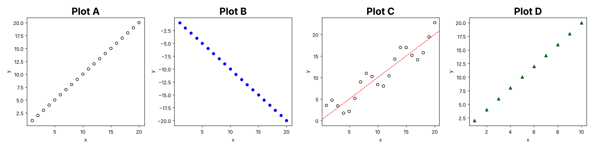
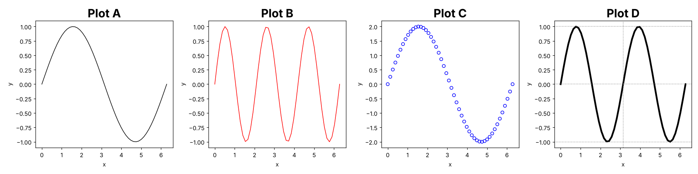

# R Programming for Beginners: Practice Exams 6 and 7 (FEM11151)

These two exams have the same 10-part structure as Exams 1–5 and cover the reader and Lectures 2–7. Solutions with explanations are in `R_practice_exams_3_solutions.md`.

| # | Part |
|---|---|
| 1 | Dataset outputs |
| 2 | RMarkdown (YAML header and broken chunks) |
| 3 | Plotting function: give the calls for the plots shown |
| 4 | Writing functions: fill in the blanks |
| 5 | Matrices, a statistics function and `apply()` |
| 6 | Debugging dplyr and base R code, and using `lm()` |
| 7 | Dates and factors |
| 8 | Coercion |
| 9 | Indexing and data.table |
| 10 | Regular expressions and web scraping |

---
---

# Practice Exam 6

## 1. Student Results

The `students` dataset contains the results of 250 students. It was read with `fread()`:

```
> str(students)
Classes 'data.table' and 'data.frame':  250 obs. of  7 variables:
 $ id      : int  1 2 3 4 5 ...
 $ name    : chr  "Anna" "Ben" "Chloe" "David" "Emma" ...
 $ program : chr  "BSc" "MSc" "BSc" "BSc" "MSc" ...
 $ grade   : num  7.5 6 8.2 5.4 9.1 ...
 $ passed  : logi  TRUE TRUE TRUE FALSE TRUE ...
 $ year    : Factor w/ 3 levels "Y1","Y2","Y3": 1 2 1 3 2 ...
 $ enrolled: Date, format: "2023-09-01" "2022-09-01" ...
```

What is the output of the following data operations?

```r
# A.)
ncol(students)

# B.)
typeof(students[, 5])

# C.)
typeof(students$year)

# D.)
as.integer(students$year[1:5])

# E.)
class(students$enrolled); typeof(students$enrolled)

# F.)
students[1:4, mean(grade)]

# G.)
sum(!students$passed[1:5])

# H.)
students[1:5][grade > 8, name]
```

## 2. RMarkdown

Complete the YAML header so that (1) the file is rendered into a **Word** document, (2) a table of contents with **only level 1** headers is created, and (3) the **tango** syntax highlighting style is used.

Also answer:
- (4) What else must be installed on your computer to render a **pdf** instead of a Word file?
- (5) Which keyboard shortcut knits the document?

The file also contains several mistakes, so R won't render it. Spot them.

````markdown
---
title: "Student Results"
author: "Eager Student"
---

```{r setup, include = FALSE}
knitr::opts_chunk$set(echo = FALSE)
library(data.table)
library(ggplot2)
students <- fread("students.csv")
```

# Grades per Program

```{r grade-box, fig.align = "center", fig.height = four}
ggplot(students, aes(x = program, y = grade)) +
  geom_boxplot() +
  labs(title = "Grades", x = "Program", y = "Grade"
```

```{r pass-rate}
students[, .(pass_rate = mean(passed)), by = program]
```

The average grade is `r round(mean(student$grade), 1)`.

```{r grade-box}
hist(students$grade)
```
````

## 3. draw_scatter()

The function `draw_scatter()` draws `n` points around the line `y = slope * x`:

```r
draw_scatter <- function(n = 20, slope = 1, noise = 0, col = "black",
                         pch = 1, line = FALSE) {

  x <- 1:n
  y <- slope * x + noise * sin(x)

  plot(x, y, col = col, pch = pch)
  if (line) {
    abline(a = 0, b = slope, col = "red", lty = 2)
  }
}
```

a) Provide the function calls that produce the following plots. (`pch = 1`: open circle, `pch = 17`: filled triangle, `pch = 19`: filled circle.)



- **Plot A:** 20 open black circles on a straight line.
- **Plot B:** 20 filled blue points, going down.
- **Plot C:** open black circles that wiggle around a red dashed line.
- **Plot D:** 10 dark-green triangles that reach y = 20.

b) In Plot C, what do the arguments `a` and `b` of `abline()` stand for? Why is the red line exactly `y = x`?
c) Which single line, run **before** the four calls, puts all four plots in one row?

## 4. Factorials and Counting

The factorial `n! = 1 · 2 · … · n`, and by definition `0! = 1`. Complete `my.factorial()` with a loop:

```r
my.factorial <- function(n){
  result <- ___
  for(i in seq_len(n)){
    result <- ___
  }
  result
}

my.factorial(5)
# 120
my.factorial(0)
# 1
```

a) A student writes `for(i in 1:n)` instead of `for(i in seq_len(n))`. What does `my.factorial(0)` return then, and why?

Complete `count.char()`, which counts how often the single character `ch` occurs in the string `s`. Use `strsplit()`:

```r
count.char <- function(s, ch){
  chars <- ___(s, "")[[1]]
  ___(chars == ch)
}

count.char("banana", "a")
# 3
```

What do these calls return?

```r
f <- function(x) {
  if (x > 0) return("positive")
  "not positive"
}
f(5)
f(-1)

g <- function(x, y) {
  x - y
}
g(y = 10, 3)
```

## 5. Weather Forecasts

**Matrix warm-up**

```r
M <- matrix(c(4, 2, 7, 6), nrow = 2)

# A.)
det(M)

# B.)
solve(M)

# C.)
M %*% c(1, 1)

# D.)
M[M %% 2 == 0]

# E.)
rbind(M, 0)

# F.)
M * c(1, 10)
```

**Root mean squared error (multiple inputs)**

The root mean squared error (RMSE) measures how far predictions are from the actual values:

`rmse(actual, predicted) = sqrt( mean((actual - predicted)^2) )`

Complete `rmse()`. It should stop if the two vectors have different lengths:

```r
rmse <- function(actual, predicted) {
  if (___) stop("vectors must have the same length!")
  ___
}
```

Three weather models predicted the temperature for four days. The actual temperatures were `actual <- c(10, 12, 14, 16)`.

```
> forecast
    M1 M2 M3
Mon 11 10 14
Tue 12 14 10
Wed 13 14 18
Thu 16 16 12
```

a) Use `apply()` to compute the RMSE of **every model**, passing `actual` as a named extra argument.
b) Give the three RMSE values. Which model is best?
c) `apply()` passes each column as the **first** argument to the function. Why does the column still end up in `predicted`?

## 6. Palmer Penguins

You analyse the `penguins` tibble (344 penguins) from the original practice exam:

```
> head(penguins, 3)
# A tibble: 3 × 7
  species island    bill_length_mm bill_depth_mm flipper_length_mm body_mass_g sex
  <fct>   <fct>              <dbl>         <dbl>             <int>       <int> <fct>
1 Adelie  Torgersen           39.1          18.7               181        3750 male
2 Adelie  Torgersen           39.5          17.4               186        3800 female
3 Adelie  Torgersen           40.3          18                 195        3250 female
```

Spot the mistake in each snippet:

```r
# A.)
penguins %>%
  select(species, island, body_mass_g) %>%
  filter(sex == "female")

Error in `filter()`:
  In argument: `sex == "female"`.
Caused by error:
  object 'sex' not found

# B.)
penguins %>%
  count(species) %>%
  arrange(desc(N))

Error in `arrange()`:
  Caused by error:
  object 'N' not found

# C.)
penguins %>%
  ggplot(aes(x = flipper_length_mm, y = body_mass_g, colour = species)) +
  geom_point() +
  labs(title = "Penguins", x = "Flipper", y = "Mass" +
  theme_minimal()

Error in "Mass" + theme_minimal() :
  non-numeric argument to binary operator

# D.)  No error, but the result still has all 344 rows. Why?
subset(penguins, species = "Adelie")
```

You model body mass by flipper length:

```r
res <- lm(body_mass_g ~ flipper_length_mm, data = penguins)
```

a) Two penguins have no flipper length and no body mass. How long is `res$residuals`?
b) `res$coefficients[2]` is about 50. What does this number mean?
c) Fill in the blanks to draw the scatterplot with filled points coloured by species (the factor codes as colours), plus the regression line:

```r
plot(___, data = penguins, pch = 19, col = ___)
abline(___, lwd = 2)
```

## 7. Dates and Factors

```r
# A.)
d <- as.Date(c("01/03/2025", "15/08/2025"), format = "%d/%m/%Y")
d

d[2] - d[1]

quarters(d)

format(d, "%Y")

# B.)
seq(as.Date("2025-03-01"), by = "week", length.out = 3)

weekdays(as.Date("2025-03-01"))

# C.)
difftime(as.Date("2025-01-02"), as.Date("2025-01-01"), units = "mins")

# D.)
library(lubridate)
month(as.Date("2025-08-15"))

wday(as.Date("2025-08-15"), label = TRUE)

# E.)
f <- factor(c("b", "a", "c", "a"), levels = c("c", "b", "a"))
as.integer(f)

table(f)

levels(f)[levels(f) == "a"] <- "A"
f

# F.)
o <- factor(f, ordered = TRUE)
o > "b"

library(plyr)
revalue(f, c("b" = "B"))
```

## 8. Coercion

What does each line return?

```r
x <- c(a = 1L, b = 2L)
x["b"] <- "two"
typeof(x); x

y <- c(TRUE, FALSE)
y + 1L
typeof(y + 1L); typeof(y + 1)

z <- c(1, 2, 3)
z[5] <- TRUE
z

m <- cbind(1:2, c(TRUE, FALSE))
typeof(m); m

l <- list(1L, 2.5)
typeof(unlist(l))

as.numeric(TRUE) + as.numeric("3")

as.integer(c("7", "7.9", "abc"))
```

## 9. Indexing and data.table

**Matrices and lists (Lecture 5)**

```r
x_mat <- matrix(1:12, nrow = 3)

# A.)
x_mat[2, ]

# B.)
x_mat[, c(1, 4)]

# C.)
x_mat[10]

# D.)
x_mat[x_mat %% 5 == 0]

# E.)
which(x_mat > 10)

l <- list(1:3, letters[1:2], list(TRUE))

# F.)
class(l[[3]])

# G.)
l[[3]][[1]]
```

**data.table (Lecture 6)**

```r
library(data.table)
dt <- data.table(city = c("Rotterdam", "Utrecht", "Rotterdam", "Delft", "Utrecht"),
                 temp = c(12, 15, 10, 14, 13),
                 rain = c(TRUE, FALSE, TRUE, TRUE, FALSE))

# H.)
dt[, .N, by = city]

# I.)
dt[rain == TRUE, mean(temp)]

# J.)
dt[, .(max_temp = max(temp)), keyby = city]

# K.)
dt[order(temp)][.N, city]

# L.)
dt[city %chin% c("Delft", "Utrecht"), sum(temp)]
```

Write the code, using `students` from Part 1:

a) Count the students per program **and** year, sorted by both.
b) Compute the mean grade of the BSc students who passed.
c) Return the names of the three students with the highest grades.
d) Add a column `grade_rounded` with the rounded grade, by reference.
e) How many students have a grade between 5.5 and 6.5?

## 10. Regular Expressions and Web Scraping

```r
tweets <- c("Loving #rstats today!", "Exam on 2025-01-20 :(",
            "@prof thanks #R #exam", "no tags here")

# A.)
grepl("#", tweets)

# B.)
grep("[0-9]", tweets)

# C.)
regmatches(tweets[3], gregexpr("#[[:alnum:]]+", tweets[3]))[[1]]

# D.)
sub("#[[:alnum:]]+", "", tweets[3])

# E.)
gsub("[[:punct:]]", "", tweets[2])

# F.)
gsub("\\s+", " ", "a   b    c")

# G.)
as.numeric(strsplit("2025-01-20", "-")[[1]][2])

# H.)
lengths(regmatches(tweets, gregexpr("#", tweets)))
```

I.) Web scraping:
1. You scrape country names with `page %>% html_nodes(".country-name") %>% html_text()` and get strings like `"\n   United Arab Emirates\n  "`. A classmate cleans them with `gsub("\\s", "", x)`. What goes wrong?
2. How do you find out **how many** tables a parsed page `page` contains?

---
---

# Practice Exam 7

## 1. Daily Weather

The `weather` dataset contains daily weather data for 2024, read with `read.csv()` and then cleaned:

```
> str(weather)
'data.frame':   366 obs. of  6 variables:
 $ date   : Date, format: "2024-01-01" "2024-01-02" ...
 $ station: chr  "Rotterdam" "Rotterdam" "Rotterdam" ...
 $ temp   : num  5.2 4.8 6.1 3.9 2.5 ...
 $ rain_mm: num  0 2.4 0 7.1 NA ...
 $ windy  : logi  FALSE TRUE FALSE TRUE TRUE ...
 $ season : Factor w/ 4 levels "autumn","spring",..: 4 4 4 4 4 ...
```

What is the output of the following data operations?

```r
# A.)
length(weather)

# B.)
typeof(weather[, 3])

# C.)
class(weather[3])

# D.)
levels(weather$season)

# E.)
mean(weather$rain_mm[1:5]); mean(weather$rain_mm[1:5], na.rm = TRUE)

# F.)
weather$date[1] + 31

# G.)
sum(weather$windy[1:5])

# H.)
weekdays(weather$date[1])
```

## 2. RMarkdown

Complete the YAML header so that (1) the file is rendered into a **pdf** document, (2) a table of contents with level 1 and 2 headers is created, (3) data frames are printed as **kable** tables, and (4) the font size is **11pt**.

(5) Which output format would you use for **HTML slides** instead?

Spot the mistakes that stop the file from rendering:

````markdown
---
title: "Weather Report 2024"
author: "Eager Student"
---

```{r setup, include = FALSE}
knitr::opts_chunk$set(echo = TRUE, fig.align = 'center')
weather <- read.csv("weather.csv")
weather$date <- as.Date(weather$date)
```

# Temperature over the Year

```{r temp-plot}
plot(temp ~ date, data = weather, type = "l", col = "steel blue")
```

The mean temperature was `r Mean(weather$temp)` degrees.

```{r windy, eval = TRUE echo = FALSE}
aggregate(windy ~ season, data = weather, FUN = sum)
```

```{r rain}
aggregate(rain_mm ~ season, data = weather, FUN = mean)
````

## 3. draw_wave()

The function `draw_wave()` draws a sine wave over one full circle (0 to 2π):

```r
draw_wave <- function(freq = 1, amp = 1, n = 50, col = "black",
                      type = "l", lwd = 1, grid = FALSE) {

  x <- seq(0, 2 * pi, length.out = n)
  y <- amp * sin(freq * x)

  plot(x, y, type = type, col = col, lwd = lwd)
  if (grid) {
    abline(h = c(-amp, 0, amp), v = pi, col = "grey", lty = 3)
  }
}
```

a) Provide the function calls that produce the following plots.



- **Plot A:** one black sine wave.
- **Plot B:** a red line with three waves.
- **Plot C:** blue open circles, with values between −2 and 2.
- **Plot D:** a thick black line with two waves and grey dotted helper lines.

b) How many circles does Plot C contain?
c) Describe exactly which helper lines `abline(h = c(-amp, 0, amp), v = pi, ...)` draws in Plot D.
d) Recreate Plot B with ggplot2, using `geom_line(colour = "red")` and `theme_bw()`.

## 4. Running Maximum and Palindromes

The **running maximum** of a vector is the largest value seen so far at each position. For example, `c(3, 1, 4, 1, 5)` gives `c(3, 3, 4, 4, 5)`. Complete `my.cummax()`:

```r
my.cummax <- function(x){
  out <- numeric(length(x))
  out[1] <- ___
  for(i in 2:length(x)){
    out[i] <- ___(out[i - 1], x[i])
  }
  out
}
```

A **palindrome** reads the same forwards and backwards. Complete `is.pal()` using `strsplit()` and `rev()`:

```r
is.pal <- function(s){
  chars <- strsplit(s, "")[[1]]
  ___(chars == ___(chars))
}

is.pal("level")
# TRUE
```

a) What does `is.pal("Level")` return, and why?

b) Multiple outputs: complete `stats3()` so that it returns a named list with the minimum, the maximum and the range width:

```r
stats3 <- function(x) {
  ___(min = min(x), max = max(x), width = ___)
}
res <- stats3(c(4, 9, 2))
res$width
# 7
```

c) What is `y` after this code?

```r
h <- function(n) {
  for (i in 1:n) {
    i * 2
  }
}
y <- h(3)
y
```

## 5. Test Scores

**Matrix warm-up**

```r
X <- cbind(x1 = c(1, 2, 3), x2 = c(4, 5, 6))

# A.)
dim(X)

# B.)
colnames(X)

# C.)
X[, "x2"]

# D.)
t(X) %*% X

# E.)
apply(X, 1, max)

# F.)
colMeans(X)
```

**Min-max scaling with `apply()`**

`scale01(x) = (x - min(x)) / (max(x) - min(x))` rescales a vector to [0, 1]. Complete `scale01()`:

```r
scale01 <- function(x) {
  ___
}
```

Consider the matrix `scores` with results of four students on three tests:

```
> scores
     T1  T2 T3
Ann  50  80 70
Ben  70  60 90
Cem  90  70 50
Dee  60 100 70
```

a) `S <- apply(scores, 2, scale01)` scales every **test**. Give the dimensions of `S` and its first column.
b) What are the dimensions of `apply(scores, 1, scale01)`? Why are they different from a)?
c) `rowMeans(S)` gives each student's average scaled score. Which student is best?

## 6. Bike Sharing Chicago

You work with `Chicago.agg` (Lecture 4, see Exam 2) with the columns `week`, `usertype`, `gender`, `events`, `temperature`, `tripduration` and `no.customers`. Spot the mistakes:

```r
# A.)
Chicago.agg %>%
  group_by(events) %>%
  summarize(M = mean(tripduration)) %>%
  filter(events = "rain")

Error in `filter()`:
  We detected a named input.
  This usually means that you've used `=` instead of `==`.

# B.)
Chicago.agg %>%
  ggplot(aes(x = temperature, y = tripduration)) +
  geom_point(colour = usertype)

Error: object 'usertype' not found

# C.)
aggregate(no.customers ~ week, FUN = sum, data = chicago.agg)

Error: object 'chicago.agg' not found

# D.)
boxplot(tripduration ~ events, data = Chicago.agg, main = Trip duration)

Error: unexpected symbol in "boxplot(tripduration ~ events, data = Chicago.agg, main = Trip duration"
```

You fit a model (assume there are no missing values):

```r
res <- lm(tripduration ~ temperature + events, data = Chicago.agg)
```

a) How long is `res$fitted.values`?
b) `events` is a character column. How does `lm()` handle it, and which category becomes the reference?
c) Fill in the blanks to draw the residuals against the fitted values, with a dashed blue line at 0:

```r
plot(___, ___, xlab = "fitted", ylab = "residuals")
abline(h = ___, col = "blue", lty = ___)
```

## 7. Dates and Factors

```r
# A.)
as.Date("March 5, 2025", format = "%B %d, %Y")

d <- as.Date("2025-03-05")
format(d, "%d/%m/%y")

weekdays(d)

as.numeric(d - as.Date("2025-01-01"))

# B.)
seq(d, by = "2 weeks", length.out = 3)

# C.)
library(lubridate)
as.Date("2024-02-29") %m+% years(1)

as.duration(as.Date("2025-01-01") %--% as.Date("2025-01-15")) / ddays(1)

# D.)
sizes <- factor(c("M", "S", "L", "M"), levels = c("S", "M", "L"),
                labels = c("small", "medium", "large"))
sizes

as.integer(sizes)

levels(sizes)[3] <- "big"
table(sizes)

levels(relevel(sizes, ref = "big"))

# E.)
o <- factor(sizes, ordered = TRUE)
o[o > "small"]

range(o)
```

## 8. Coercion

```r
typeof(c(1.0, 2L))

v <- c("a", NA)
typeof(v); is.na(v)

as.logical(c(TRUE, "FALSE"))

x <- 1:5
x[x > 2] <- 0
x; typeof(x)

sum(c("1", "2"))

sum(as.integer(c("1", "2")))

f <- factor(c("3", "1", "3"))
as.numeric(f)
as.numeric(levels(f))[f]

typeof(Sys.Date()); class(Sys.Date())
```

## 9. Indexing and data.table

**Vectors and lists (Lecture 5)**

```r
x <- c(10, NA, 30, 40, NA)

# A.)
x[!is.na(x)]

# B.)
which(is.na(x))

# C.)
sum(x > 15, na.rm = TRUE)

# D.)
x[c(-1, -2)]

# E.)
x %in% c(10, 40)

lst <- list(scores = c(7, 8, 9), info = list(name = "Ann", year = 2))

# F.)
lst$info$name

# G.)
lst[["scores"]][lst[["scores"]] > 7]

# H.)
class(lst["info"])
```

**data.table (Lecture 6)**

```r
library(data.table)
dt <- data.table(prod  = c("tea", "coffee", "tea", "juice", "coffee", "tea"),
                 qty   = c(2, 1, 3, 4, 2, 1),
                 price = c(1.5, 2.5, 1.5, 3.0, 2.5, 1.5))

# I.)
dt[, .N, by = prod]

# J.)
dt[, .(revenue = sum(qty * price)), by = prod]

# K.)
dt[qty > 1, unique(prod)]

# L.)
dt[, sum(qty), keyby = prod]

# M.)
dt[prod %like% "e", .N]
```

Write the code, using `wt <- as.data.table(weather)` from Part 1:

a) Compute the mean temperature per season, sorted by season.
b) How many days were windy **and** had more than 5 mm of rain?
c) Return the dates and temperatures of the three warmest days.
d) How many summer days had a temperature between 15 and 20 degrees?
e) What is the difference between `wt[.N]` and `nrow(wt)`?

## 10. Regular Expressions and Web Scraping

```r
files <- c("report_2024.pdf", "data_final.csv", "Data_v2.CSV",
           "notes.txt", "image01.png")

# A.)
grepl("csv", files)

# B.)
grepl("csv", files, ignore.case = TRUE)

# C.)
sub("\\.[a-z]+", "", files)

# D.)
gsub("[0-9]", "", files)

# E.)
grep("[0-9]{2}", files, value = TRUE)

# F.)
strsplit(files[1], "[_.]")[[1]]

# G.)
lengths(regmatches(files, gregexpr("[0-9]+", files)))

# H.)
sub(".", "-", "a.b"); sub("\\.", "-", "a.b")
```

I.) Web scraping:
1. What is the difference between `html_node()` and `html_nodes()`?
2. You scraped a table with `html_table()`, but the column `Population` is a character column like `"17,947,406"`. Convert it into numbers.
3. Name the functions that `rvest` offers for **XML** files (Lecture 7).
